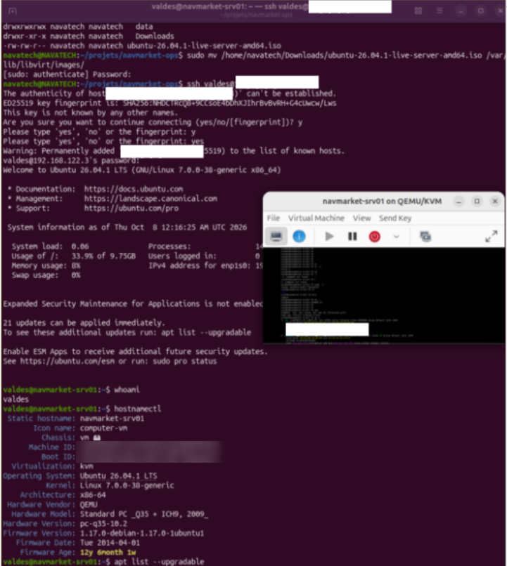

# S1.1 - First server: `navmarket-srv01`

**Session 1 / 24 · Linux 1: using it** · Completed on 8 October 2026

## Goal

NavMarket needs its first server. Install Ubuntu Server, name it `navmarket-srv01` and bring it fully up to date.

**Done when:**

1. `hostnamectl` shows `navmarket-srv01`;
2. `apt list --upgradable` lists nothing left to install;
3. I know whether a reboot is needed, and how I know it.



## Architecture

```
Workstation NAVATECH (Ubuntu 26.04 LTS)
│
├── virt-manager / virsh   → user interfaces
├── libvirt (libvirtd)     → manages the VMs
├── QEMU                   → creates the virtual hardware
└── KVM (kernel module)    → runs the VM on the real CPU
        │
        └── VM navmarket-srv01 (Ubuntu Server 26.04.1 LTS)
            2 vCPU · 2 GB RAM · 20 GB disk · NAT network (virbr0, 192.168.122.0/24)
            reached from the workstation over SSH
```

I chose a **local VM** for the first labs: snapshots let me break things and go back in seconds. A public server comes in lab S1.5.

## What I did

### 1. Prepare the workstation for virtualisation

```bash
lsmod | grep kvm          # KVM is already a kernel module: kvm + kvm_intel/kvm_amd
ls -l /dev/kvm            # the device file programs use to talk to KVM
sudo apt install cpu-checker qemu-kvm libvirt-daemon-system virt-manager
kvm-ok                    # the CPU supports hardware virtualisation
id                        # check that my session belongs to the libvirt group
```

KVM itself is never "installed": it comes with the Linux kernel. What I installed are the layers on top of it: QEMU (virtual hardware), libvirt (VM management) and virt-manager (graphical interface).

### 2. Create the VM

- ISO: Ubuntu Server 26.04.1 LTS, copied to `/var/lib/libvirt/images/` (see problem 2).
- virt-manager: 2048 MB RAM, 2 vCPU, 20 GB disk, default NAT network.
- Installer: hostname `navmarket-srv01`, **OpenSSH server** selected, no extra snaps.

### 3. Work over SSH, like on a real server

```bash
ssh <user>@<VM_IP>        # from the workstation; the VM gets its IP from libvirt's DHCP
```

### 4. Set the names

The hostname and the VM name are two **independent** names:

| Name | Where it lives | How I set it |
| --- | --- | --- |
| Hostname | inside the VM (`/etc/hostname`) | `sudo hostnamectl set-hostname navmarket-srv01` |
| Local name resolution | inside the VM (`/etc/hosts`, line `127.0.1.1`) | `sudo nano /etc/hosts` |
| VM name (libvirt) | on the workstation | `virsh domrename <old> navmarket-srv01` (VM shut off) |

### 5. Update the server

```bash
sudo apt update && sudo apt upgrade   # refresh the package list, then install the new versions
apt list --upgradable                 # what is still upgradable?
ls /var/run/reboot-required           # does a reboot need to happen?
sudo poweroff                         # clean shutdown before the snapshot
```

### 6. Snapshot

```bash
virsh snapshot-create-as navmarket-srv01 S1.1-clean \
  --description "Ubuntu 26.04.1 installed, hostname set, fully updated"
virsh start navmarket-srv01
```

## Proof

Full outputs: [`S1.1-proofs.txt`](S1.1-proofs.txt), collected over SSH with a Bash loop that prints each command before its output.

- `hostnamectl` → `Static hostname: navmarket-srv01`, `Operating System: Ubuntu 26.04.1 LTS`, `Virtualization: kvm`
- `/etc/hosts` → `127.0.1.1 navmarket-srv01`
- `virsh list --all` → `navmarket-srv01   running`
- `virsh snapshot-list navmarket-srv01` → `S1.1-clean`
- `apt list --upgradable` → only 2 packages left: Ubuntu gives some updates to machines step by step (**phased updates**), and `apt upgrade` waits until this machine is included. This is normal.

## Problems and solutions

### Problem 1: virt-manager "Not connected" without `sudo`

**Symptom:** `virsh -c qemu:///system list --all` → `Failed to connect socket to '/var/run/libvirt/libvirt-sock': Permission denied`. It only worked with `sudo`.

**Cause:** `sudo adduser navatech libvirt` answered *already a member*, but `id` did not list `libvirt`. The group was in `/etc/group`, but **a session's groups are read at login**: my session was opened before I was added to the group.

**Solution:** log out and log in again. Running the graphical interface as root with `sudo virt-manager` would have hidden the problem and is a security risk.

### Problem 2: the VM could not read the ISO

**Symptom:** the ISO in `~/Downloads` could not be opened by the VM.

**Cause:** QEMU does not run as me but as the system user `libvirt-qemu`. `namei -l` shows the rights of every folder on the path:

```
drwxr-x--- navatech navatech navatech      ← "others" have no x: libvirt-qemu cannot enter my home
lrwxrwxrwx navatech navatech Downloads -> /mnt/data/Downloads
```

**Solution:** copy the ISO to `/var/lib/libvirt/images/`, the standard folder for VM images, instead of opening my home folder to everyone.

### Problem 3: Ubuntu 26.04 missing from the OS list

**Symptom:** virt-manager did not offer Ubuntu 26.04 in its list of systems.

**Cause:** the list comes from a database (`osinfo-db`) that did not know this version yet. This choice only sets the default virtual hardware; the ISO decides what is installed.

**Solution:** keep the 26.04.1 ISO and choose the closest version in the list, Ubuntu 24.04.

## What I learned

- KVM is part of the Linux kernel; QEMU, libvirt and virt-manager are the layers on top of it.
- `apt update` refreshes the package **list**; `apt upgrade` installs the new **versions**. Always in this order.
- A session's groups are read at login: after adding a user to a group, log in again.
- Services often run as their own system user (`libvirt-qemu`): I check the rights of **that** user. `namei -l` shows the rights on the whole path.
- The hostname, `/etc/hosts` and the VM name in libvirt are three separate things.
- `sudo poweroff` stops the services cleanly and writes the data to disk; "force off" is like pulling the power cable.
- `>` creates or replaces a file, `>>` adds to the end; `2>&1` also captures error messages.
- Working over SSH from my workstation is the normal way to run a server; a snapshot is a safety net before every lab.

## Quick questions

**What is the difference between `apt update` and `apt upgrade`?**
`apt update` downloads the latest list of packages. `apt upgrade` installs the new versions. Always run `update` first.

**How do I know if a reboot is needed?**
If the file `/var/run/reboot-required` exists, Ubuntu needs a reboot.
