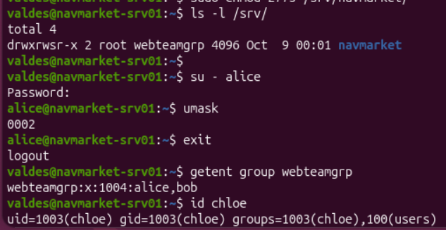

# S1.2 - Accounts alice, bob, chloe and permissions on `/srv/navmarket`

**Session 1 / 24 · Linux 1: using it** · Completed on 9 October 2026

## Goal

NavMarket is hiring. Three people need an account on `navmarket-srv01` and access to the website files:

| Account | Role | Rights on `/srv/navmarket` |
| --- | --- | --- |
| alice | Web developer | read + write |
| bob | Web developer | read + write |
| chloe | Intern, reviews the site | read only |

**Done when:**

1. alice creates a file in `/srv/navmarket`, and bob can modify it without any `chmod`;
2. chloe can read that file, but gets `Permission denied` when she tries to write;
3. every permission can be explained with `ls -l` and `namei -l`.



## Design

| Decision | Choice | Why |
| --- | --- | --- |
| Location | `/srv/navmarket` | Linux puts data **served** by the machine (web, FTP) in `/srv`. Website files are not personal data, so they don't belong in a `/home`. |
| Owner | `root` | A shared folder should not belong to one person: if alice leaves and her account is deleted, nothing breaks. |
| Group | `webteamgrp` (alice, bob) | Rights are given to a **group**, not to each person: when the team changes, I change one group, not every file. |
| Mode | `2775` (`drwxrwsr-x`) | see below |

**The mode `2775`, digit by digit:**

| Digit | Value | Rights | For whom |
| --- | --- | --- | --- |
| 1st | 2 | setgid | new files get the folder's group |
| 2nd | 7 | `rwx` | owner `root` |
| 3rd | 7 | `rwx` | group `webteamgrp` |
| 4th | 5 | `r-x` | others, which includes chloe |

On a **folder**, `r` lets you list the names, `w` lets you create or delete files inside, and `x` lets you enter it.

## What I did

```bash
sudo adduser alice                    # same for bob and chloe
sudo addgroup webteamgrp
sudo adduser alice webteamgrp         # same for bob; chloe stays outside the group
sudo mkdir /srv/navmarket             # /srv belongs to root, so sudo is required
sudo chown root:webteamgrp /srv/navmarket
sudo chmod 2775 /srv/navmarket
ls -ld /srv/navmarket                 # drwxrwsr-x root webteamgrp: the "s" is setgid
```

### Tests

| # | Who | Action | Result |
| --- | --- | --- | --- |
| T1 | alice | `touch /srv/navmarket/index.html` | ✅ created |
| T2 | admin | `ls -l` on the file | ✅ group `webteamgrp`, thanks to setgid |
| T3 | bob | edits the file with `nano` | ✅ saved |
| T4 | chloe | `cat index.html` | ✅ readable |
| T5 | chloe | edits the file / `touch m.js` | ❌ `Permission denied`, as expected |

## Proof

Full outputs: [`S1.2-proofs.txt`](S1.2-proofs.txt), collected on the server with `sudo -u <user>`, which runs a command as another user.

- `getent group webteamgrp` → `alice,bob`; `id chloe` → not in `webteamgrp`
- `ls -ld /srv/navmarket` → `drwxrwsr-x root webteamgrp`
- `ls -l /srv/navmarket` → `-rw-rw-r-- alice webteamgrp index.html`: created by alice, group from the folder, writable by the group
- `namei -l /srv/navmarket/index.html` → every folder on the path can be entered by others
- `sudo -u chloe touch /srv/navmarket/test-chloe` → `Permission denied`

## Why bob can edit alice's file: setgid + umask

Two things must be true at the same time:

1. **setgid on the folder**: without it, `index.html` would belong to alice's own group `alice`, and bob, who is not in it, could not write.
2. **umask `0002`**: new files start at `666`, and the umask removes rights, so `666 - 002 = 664` (`rw-rw-r--`). With a umask of `0022`, the file would be `644` and bob would be refused despite setgid. On Ubuntu, each user has their own group with the same name (`alice:alice`, `bob:bob`), so `0002` is safe by default.

## Problems and solutions

### chloe needs `5`, not `4`

**Symptom:** my first plan gave "others" the right `4` (`r--`) on the folder.

**Cause:** on a folder, `r` only lists the file names. Without `x`, chloe could not enter the folder and open the files.

**Solution:** `5` (`r-x`) for others, so the mode is `2775`.

## What I learned

- `/srv` is the standard place for data served by the machine.
- Rights go to **groups**; a shared folder is owned by `root` and a team group.
- `rwx` means something different on a folder: `x` is the right to enter.
- The **setgid** bit on a folder makes new files get its group.
- The **umask** decides the rights of new files; `0002` lets a team share files.
- Test permissions as the real user with `sudo -u`, and keep the failing test as proof.
- `sudo -u bob echo "text" >> file` does not test bob's rights: `>>` is done by **my** shell before `sudo` runs. The right form is `echo "text" | sudo -u bob tee -a file`.
- Limit of this design: "others" means **every** user on the server. To give read access to chloe only, I will need ACLs (`setfacl`).

## Quick questions

**What does setgid do on a folder?**
New files get the group of the folder, so the whole team can edit them.

**Why does a user need `x` on a folder?**
`r` only lists the file names. `x` is needed to enter the folder and open the files.
